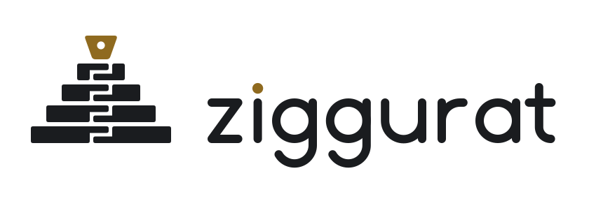

  <picture>
    <source media="(prefers-color-scheme: dark)" srcset="./assets/ziggurat-lockup-dark.svg">
    
  </picture>

<h3 align="center">Simple on the surface. Engineered all the way down.</h3>

We build websites, applications and platforms, and the ground they stand on. 

---

### What we build

Every project gets four tiers. You only ever touch the top one.

| Tier | What it covers | Tools |
|---|---|---|
| **04 · Product** | Backends, frontends, data | Go · Python · Django · Java · Next.js · React · PostgreSQL |
| **03 · Signal** | Monitoring, alerting, load testing | Prometheus · VictoriaMetrics · Grafana · k6 · OpenTelemetry · Sentry |
| **02 · Runtime** | Containers, orchestration, delivery | Docker · Podman · Kubernetes · Helm · Traefik · GitHub Actions |
| **01 · Ground** | Servers, hardening, private network | Linux · Ubuntu · Debian · Ansible · WireGuard |

### How we work

1. **Understand.** Your business, your users, and the availability they expect. That becomes the SLO.
2. **Design simple.** The fewest moving parts that meet the SLO.
3. **Build.** Agent-assisted development inside reviewed workflows. Every change is tested.
4. **Ship.** Infrastructure as code, a pipeline for every service, load tests before launch.
5. **Hand over.** Repos, docs and dashboards. Any developer can carry on after us.

### Why "Ziggurat"

Chogha Zanbil, the ziggurat in Khuzestan, looks like a few plain steps, and took some of the best engineers of the ancient world to build. A zipper is the same: everyone uses one, and few notice the engineering in its teeth. Our mark is both: a ziggurat whose tiers lock together like a zipper, with the slider on top. The slider is the one part you touch.
